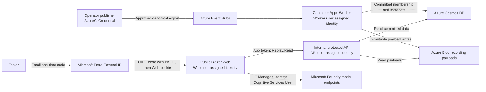
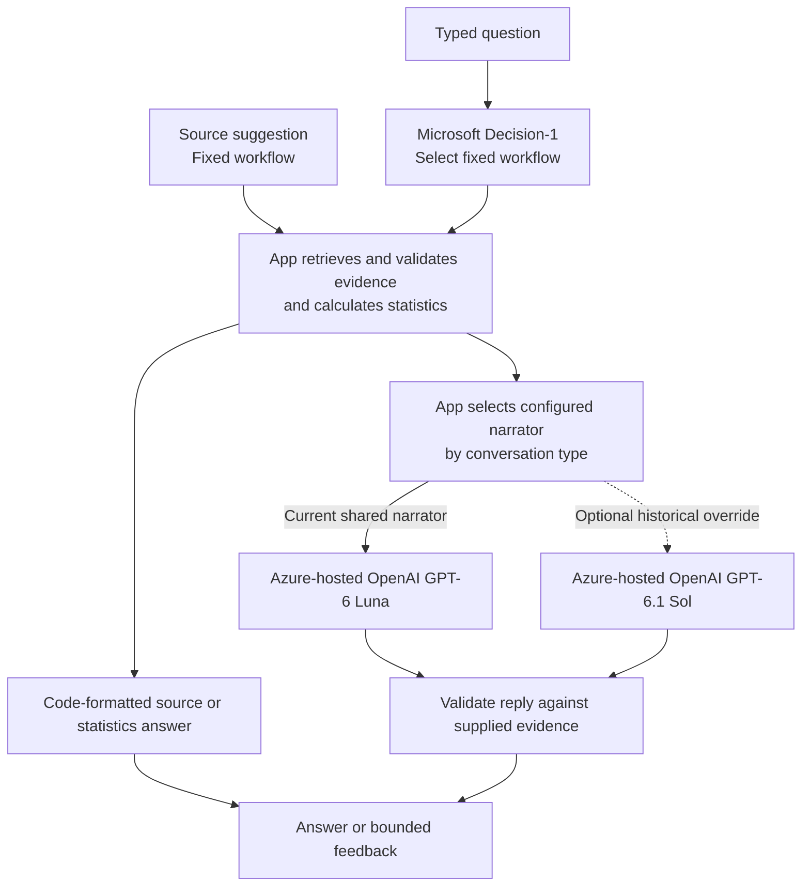

# How Matchmate works

The live vision is for incoming football observations to drive the pitch, calculated statistics, insights and conversation through one shared path. Today's recorded inputs exercise parts of that path. Matchmate separates football evidence from the language used to explain it: code validates records and calculates statistics; models can select a bounded workflow or explain its evidence, while some answers use code alone.

The current stack is **.NET 11 RC2**, **Blazor Interactive Server** and **Aspire 13.5.3**, with separate Web, API and Worker applications.

## Azure deployment and identity

The application runs on a **Microsoft/Azure stack**: .NET 11 RC2, Blazor Interactive Server and Aspire, with separate Web, API and Worker services on Azure Container Apps. All configured AI model calls use Microsoft Foundry endpoints, including the Azure-hosted OpenAI narrators. The public Web service calls an internal protected API; Worker ingestion and data storage stay behind that boundary.

The Worker accepts normalized records from Event Hubs, writes immutable recording payloads to Blob Storage and commits their membership/metadata in Cosmos DB. The internal API reads the accepted data. Web retrieves football evidence through that API; it does not read the football store directly. A replay cursor remains separate from incoming ingestion.

**Human sign-in and service access use different identities.** The browser signs in through Entra External ID email one-time codes, using OpenID Connect authorization code with PKCE. Web then creates a server authentication cookie and requires the **Tester** role. For API calls, Web obtains its own application token; it does not forward the tester's token. The API checks issuer, audience, lifetime, the **Replay.Read** app role and the expected Web caller.

| Caller or identity | Access and boundary |
| --- | --- |
| Developer/operator using Azure CLI | Explicit `AzureCliCredential` for authorized preparation, publishing or local inference. Its Azure permissions are separate from browser Tester access. |
| Web user-assigned managed identity | Calls the internal API with its app role; has **Cognitive Services User** scoped to the dedicated Foundry account for model inference. |
| Worker user-assigned managed identity | Event Hubs Data Receiver; Blob Data Contributor on recording/checkpoint containers; Cosmos DB data contributor on the replay scope. |
| API user-assigned managed identity | Blob Data Reader on recording payloads and Cosmos DB data reader on the replay scope. |
| Web identity for authentication support | Key Vault Secrets User for the referenced OIDC client secret; Blob Data Contributor on the separate Data Protection key container. |
| Foundry account/project system-assigned identities | Belong to the Foundry resources; they are separate from the three application user-assigned identities. |

Web, API and Worker each have a **separate user-assigned managed identity**. AI and football-data access are keyless, but the whole application is not secret-free: Web's confidential OIDC client still uses a client secret supplied by a Key Vault reference. Cookie Data Protection keys persist in a separate Blob container so authentication survives instance changes. No secret values or environment identifiers are supplied in these documents.

Trace the implementation in [Web hosting/credentials](../src/Matchmate.Web/Authentication/HostedWeb.cs), [External ID authentication](../src/Matchmate.Web/Authentication/ExternalIdAuthentication.cs), [API service authentication](../src/Matchmate.Api/ServiceAuthentication.cs) and [Azure football resources](../src/Matchmate.Infrastructure/AzureFootballResources.cs). The deployment sources define [app identities/ingress](../infra/container-apps/apps.bicep), [authentication support](../infra/container-apps/foundation.bicep), [pipeline roles](../infra/container-apps/pipeline-access.bicep) and [Foundry models/inference roles](../infra/foundry-models/main.bicep).

## Delivery and operations

Container Apps pull images from Azure Container Registry using a **separate registry-pull user-assigned identity** with registry-scoped **AcrPull**, rather than the Web/API/Worker identities. The [registry access template](../infra/azure-foundation/registry-access.bicep) separately grants the publisher identity **AcrPush** and **Reader**. The [development deployment workflow](../.github/workflows/deploy-development.yml) uses GitHub Actions OIDC (`id-token: write`, `azure/login@v3`) and federated registry login, compiles Bicep, runs ARM validation/what-if and deploys Container Apps. Federated trust must already be configured; the cited Bicep does not establish that trust.

The [environment foundation](../infra/container-apps/foundation.bicep) declares Log Analytics environment logging with **30-day retention**. Its workspace-key integration means the entire infrastructure should not be described as keyless. [ServiceDefaults](../src/Matchmate.ServiceDefaults/Extensions.cs) instruments OpenTelemetry logs, traces and metrics, adding OTLP exporters only when `OTEL_EXPORTER_OTLP_ENDPOINT` is configured. OTLP export requires an endpoint configured for the environment. Aspire orchestrates local services and its development dashboard; that dashboard is separate from cloud monitoring.

## One evidence path

Input adapters preserve each source's identity, time precision, quality and coverage. The Worker processes shared records, and the API supplies views that the interface and conversation can use together. A paused viewer has its own cursor; playback is not a wall-clock live feed.

Azure Container Apps host Web, API and Worker. Event Hubs carries incoming canonical records; Worker validates them and commits accepted data to Blob Storage and Cosmos DB. The API supplies recording catalogues and clock-bound queries to Web. For local development, Aspire starts the services with prepared files and a shared journal.

Match story groups completed generated actions into passages. Its Ask action keeps the visible clock and cards, while selecting a row seeks to the passage end. Eligible half-time/full-time recaps and reported/generated tables use their respective evidence at the current cursor. Story questions and Explain this moment use code-owned source paths, preserving the separation between reported events and generated facts. Decision-1 passage/data classification is postponed; question-to-workflow routing remains separate.

## Live-source direction

A permitted structured live feed would need an adapter into the common records, preserving clocks, availability, revisions and coverage before using the same downstream processing and queries. There is no connected real-time Premier League feed today.

Video alone also needs continuous decoding, calibration, detection, tracking, identity association and quality control before it can produce accepted observations. That integration is not implemented. The [video-to-replay workflow](VIDEO-TO-REPLAY.md) explains the current offline preparation tools, review steps and separate optional generated movement. A replay cursor and ongoing ingestion remain distinct concerns.

## Workflow selection and model roles

All configured model calls are served through **Microsoft Foundry**. Microsoft Decision-1 selects a **fixed workflow**, such as retrieving a club's form or the current replay statistics. Application code controls the subject, selected season/date or recording/cursor, permitted queries and evidence. The narrator deployment is configured by conversation type; Decision-1 does not choose between Luna and Sol.

| Role | Responsibility | Configuration |
| --- | --- | --- |
| Microsoft Decision-1 | Select one allowed workflow through `/providers/microsoft/v1/systemone`; no statistics calculation or narration | `DecisionRouting` |
| Azure-hosted OpenAI GPT-6 Luna | Currently selected shared narrator for replay, league and historical evidence through `AzureOpenAIClient` Chat Completions | `MatchChat:Deployment` |
| Azure-hosted OpenAI GPT-6.1 Sol | Deployed and available as an optional historical-fixture narrator; the current app has no historical override selected | `HistoricalReplyModel:Deployment` |
| Application code | Retrieve and validate evidence, calculate statistics, format deterministic answers and check model replies | Shared query and conversation services |

Source suggestions bypass Decision-1. Replay and league source answers use code; historical suggestions may still use the historical narrator, with bounded source recovery. Typed replay-statistics questions use Decision-1 and then code formatting, skipping narration; exact matches to a replay source suggestion can use its direct shortcut too.

**Decision-1, Luna and Sol are all deployed successfully in Microsoft Foundry.** The running Web configuration enables Decision-1 and selects Luna for `MatchChat:Deployment`. It has no `HistoricalReplyModel:Deployment` override, so historical narration currently uses the shared Luna deployment too. Selecting the deployed Sol model for historical narration is an explicit configuration option; deployment availability does not imply that the current route invokes it.

Narrators receive prepared evidence and must return strict JSON checked by application code. They are not Foundry Agents or controllers that select and invoke tools. The application retains workflow/query authority, statistics and evidence validation. Match story remains code-owned; Decision-1 passage/data classification is postponed. See the [Decision-1 router](../src/Matchmate.Web/Chat/DecisionWorkflowRouter.cs), [replay narrator](../src/Matchmate.Web/Chat/AzureMatchChatModel.cs) and [historical narrator](../src/Matchmate.Web/HistoricalChat/AzureHistoricalChatModel.cs).

Replies retain source and scope checks, with clarification or unavailable states when necessary. These checks reduce mistakes; they do not prove that every generated sentence is correct. Selecting an explicit goal can open a labelled retrospective event context without changing what the current replay clock knows.

## Where to look in a supplied source tree

| Component | Source-relative location |
| --- | --- |
| Process orchestration and local paths | `src/Matchmate.AppHost/Program.cs` |
| Interface, authentication and conversations | `src/Matchmate.Web/` |
| Football and league query endpoints | `src/Matchmate.Api/` |
| Recorded/Azure observation processing | `src/Matchmate.Worker/` |
| Shared contracts, calculations and storage adapters | `src/Matchmate.Contracts/`, `src/Matchmate.Core/`, `src/Matchmate.Infrastructure/` |

Offline media preparation uses Python, FFmpeg, faster-whisper and Node.js tooling. These are separate tools, not Microsoft-hosted runtime services or a connected live-video pipeline.

Persistent private conversation history, learned profiles and voice remain future work. See the [roadmap](ROADMAP.md) and [current limitations](CAPABILITIES-AND-LIMITATIONS.md).
