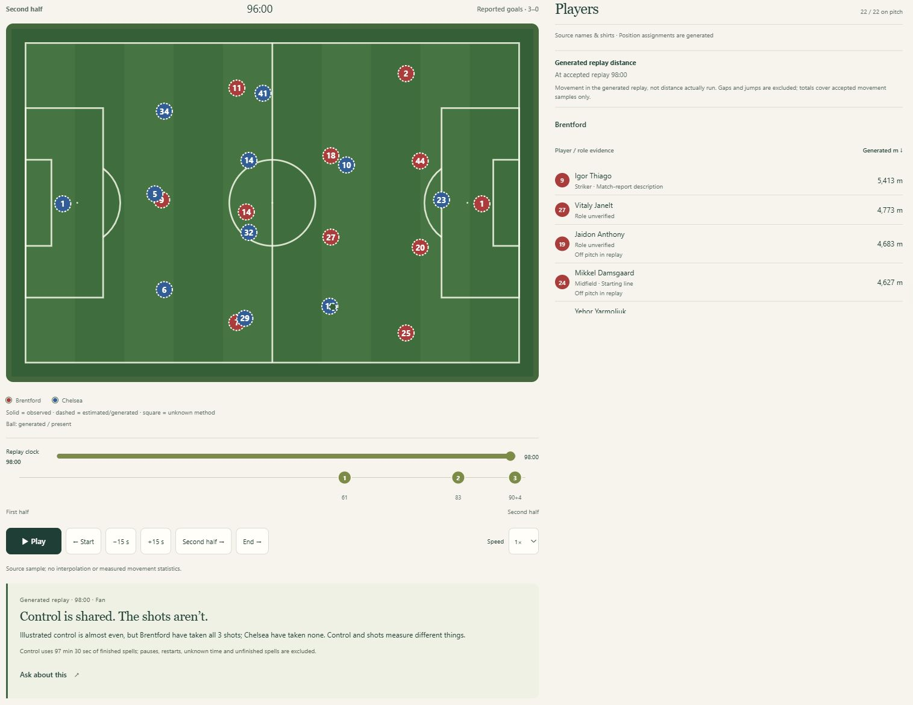

# Matchmate

**Football, in conversation.**

Matchmate explores a simple idea: what if you could talk to a match, a team or a stadium, and get an answer grounded in the football evidence available to it?

The live vision is for incoming football data to update the pitch, calculated statistics, insights and conversation together. Prepared recordings and generated illustrations demonstrate parts of that experience today; live-source integration remains future work.

The current prototype brings together a Premier League season explorer, conversations about clubs and historical results, and a recorded-match workspace with a pitch replay, player details and chat. The longer-term direction includes a personal football guide and voice.

*Brentford–Chelsea movement and distance are generated illustration, not actual tracking.* [View the full replay and statistics reply](assets/matchmate-replay-full.jpg).

Matchmate runs on **Azure Container Apps**, with Event Hubs, Cosmos DB and Blob Storage behind the replay experience. Its AI models are served through **Microsoft Foundry**, and Microsoft Entra provides sign-in and service identities. Read the [architecture](ARCHITECTURE.md) for the data flow and model roles.

[Open the hosted demo — judge access required](https://mm-web-dev.redtree-349789df.swedencentral.azurecontainerapps.io/) and follow the [judge testing instructions](JUDGE-TESTING.md). Access requires a privately arranged Tester identity; credentials are not supplied in this repository.

Both Brentford recordings offer separate reported/generated tables, recaps and Match story: **150 Chelsea / 132 Liverpool passages**. Ask prepares an unsent passage question at the visible clock; selecting a row seeks to its end. Rewind changes the evidence available to tables, recaps and conversation. [Capabilities and limitations](CAPABILITIES-AND-LIMITATIONS.md) explains what the evidence supports.

## Three questions to try

Open `/recordings`, choose the **Brentford–Chelsea generated illustration**, set English, and pause at the end of the replay, **98:00**. Try these in order:

1. **“Show replay statistics”** — inspect both teams' generated passes, shots and illustrated control, with their evidence and calculation limits.
2. **“How many shots are in this generated replay?”** — ask for one measure, keeping the generated-replay qualification and clock.
3. **“What is Chelsea’s pass accuracy?”** — inspect completed passes, finished attempts and the percentage calculated from them.

The first question has a direct source route; the typed follow-ups use the question router. Code calculates and formats these statistics from the generated replay at the selected clock. Read the [demo guide](DEMO.md#three-exact-questions) for the steps and [data and sources](DATA-AND-SOURCES.md) for the calculation boundaries.

## Take a look

- [Walk through the demo](DEMO.md) to see the intended visitor journey.
- [Get started](GETTING-STARTED.md) for build commands and the additional requirements for a running demo.
- [Understand the architecture](ARCHITECTURE.md) and how code and AI share the work.
- [Follow the path from video to replay](VIDEO-TO-REPLAY.md), with the included [football-video-to-data skill](skills/football-video-to-data/SKILL.md) and the remaining live-source work.
- [Read about data and sources](DATA-AND-SOURCES.md), including the difference between reported events and generated movement.
- [Check capabilities and limitations](CAPABILITIES-AND-LIMITATIONS.md) before interpreting the results.
- [See the roadmap](ROADMAP.md) for the wider match, team, stadium and personal-guide direction.

The interface supports English, Swedish and Spanish. Recorded-match explanations also offer Fan and Analyst styles: different wording over the same evidence.

This is a developing prototype. Its generated Brentford–Chelsea replay is an illustration, its newest season is a dated snapshot, and AI answers can still fail or ask for clarification. The documentation describes those boundaries alongside the experience.
